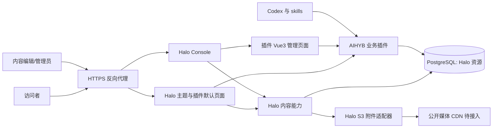
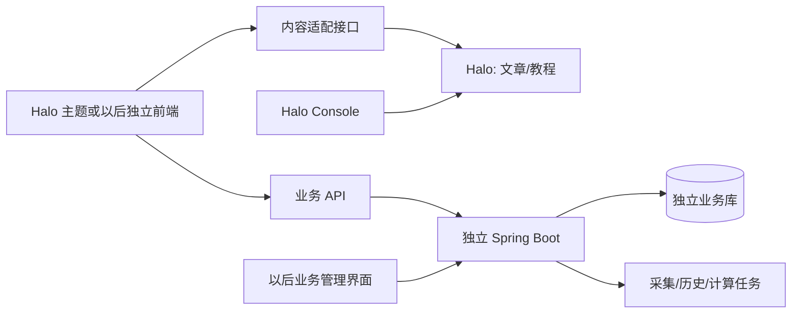

# AI好用榜 Halo 推荐架构

日期：2026-10-17｜状态：统一稿件、原生入口、两主题、发现入口隔离，以及私有S3媒体与完整历史运营专项通过；完整 PoC 仍有未验收项。

## 1. 架构结论与首版范围

**首版采用 Halo 社区版 + PostgreSQL + 成熟 Thymeleaf 主题 + 一个自有业务插件。** 插件后端使用 Java，控制台扩展使用 Vue3。采用 Docker Compose 部署；业务增长后再接入独立 Spring Boot 服务。

内容自动化由 Codex 与 skills 完成，四模块共用稿件包，插件提供一个提交入口。人工操作复用 Halo 原生文章列表、编辑、保存、预览与发布按钮，补充来源、结构化字段和明确修订审核面板。已冻结格式见[协议 1.0](../demo/halo-poc/contracts/README.md)，版本保护见[原生适配记录](./cms-native-adapter.md)。公开列表位于 `/aihyb`，详情使用原生文章路由；Earth 1.15.3 与 Anatole 2.1.0 适配及切换已验证。2026-10-17 已接入私有腾讯COS的S3兼容存储、媒体网关与完整历史运营；跨产品对比和 CDN 尚未完成，详见[媒体报告](./cms-media-operations.md)。

当前网站只包含商业计划书中的四个模块：

| 模块 | 首版页面与操作 | 数据形态 |
|---|---|---|
| 能力测评 | 测评列表、任务分类、测评详情、样例、证据与原始链接 | 稿件包 Markdown + 结构化测评记录 + 完整发布快照 |
| 评分与榜单 | 按任务查看编辑维护的榜单；展示日期、理由、来源和评分口径 | 已发布榜单快照；不在首版自动重算全网排名 |
| 价格对比 | 接收方案稿件包，后台核验/修改，按类型/任务/计费方式筛选，最多三项并排比较 | 工具、方案与核验日期；免费额度与限制均是结构化字段 |
| 使用技巧与教程 | 任务分类、步骤、提示词、适用工具、示例与失败情况 | 稿件包 Markdown + 分类/关联信息 + 完整发布快照 |

工具档案是四模块共用的内部数据模型，不是另加一个工具导航产品。首页负责四模块入口和精选内容。价格历史曲线、批量抓取、自动评分、论坛、注册、会员、交易、课程和 App 都不计入首版建设范围。

模块细节仍需 UI 设计；本文件不把成熟博客主题视为现成数据门户。首版在选定主题上适配表格、来源卡片和基础筛选即可。

## 2. 首版运行结构



首版只有一个 CMS 应用进程与一个数据库进程，加反向代理；不用同时部署独立公众前端、身份服务、搜索服务和业务后端。PoC 的模拟 API 是验证用组件，不要求生产保留。

插件建议命名 `plugin-aihyb`，按领域组织 Tool、Plan、Review、Leaderboard、Publication、PackageImport 等模块。它们属于同一插件，不按四个页面拆成四个独立服务。禁止修改 Halo 内核、直写内核表或把实体定义放主题。采集、Word 转换和 AI 生成在 Codex skills 侧完成。

Halo 核心、控制台、主题和插件的实际能力依据见 [选型报告](./cms-selection-report.md)。官方 [自定义资源](https://docs.halo.run/developer-guide/plugin/api-reference/server/extension)、[Console UI](https://docs.halo.run/developer-guide/plugin/basics/ui/intro) 与 [主题集成](https://docs.halo.run/developer-guide/plugin/theme-integration) 支持上述扩展方式；本图不代表这些模块已实现。

## 3. 数据、用户、权限、媒体与搜索归属

| 对象/能力 | 首版权威归属 | 未来边界与替换方式 |
|---|---|---|
| 稿件标题、摘要、Markdown、业务数据与完整草稿/发布版本 | ContentRevision 保存不可变整包；原生 Post 原子维护状态及公开元数据；使用 Halo 官方客户端 | 稿件包中立导出；Post 不是另一套可编辑主库；详情、列表及 DTO 读取同一发布修订 |
| 工具档案；方案、测评记录与榜单的查询数据 | 工具档案为独立插件资源；方案/测评/榜单数据由稿件发布快照派生 | 中立 JSON/CSV 导出；派生查询数据可重建；外置服务上线后逐实体移交，公共 UUID 不变 |
| 来源与核验记录 | 插件字段/关联列表；正文保留可读来源 | 自动化仍保留来源、采集批次与人工核验链路 |
| 两名运营人员账户、角色、后台会话 | Halo | 首版不建设公众账户；新服务不能直接假定理解 Halo Session |
| 模块操作权限、公开数据字段白名单 | 插件服务端 + Halo RBAC | 外置后由 Spring 服务重新授权；菜单隐藏不能代替服务端权限 |
| 图片/音视频附件与元数据 | 私有COS通过S3兼容插件保存文件，Halo管理稳定附件引用，整包管理访问属性 | 当前发布修订经网站网关读取；私有草稿不公开；CDN与长视频分发待实施 |
| 基础分类与结构化筛选 | 插件索引与公开查询 | 中文全文检索不是首版硬要求；需要时建立可重建索引，不把它作为权威库 |
| SEO、公开路由、导航和样式 | 主题 + 插件页面契约 | 换主题后要回归；换 CMS 需重写展示适配，但保留 slug 与重定向表 |
| 内容获取、文件转换、AI 整理与包生成 | Codex 与 skills；Halo 首版只接收标准包 | 大规模任务需要时独立调度；价格历史与复杂计算按需求演进 |

同一 PostgreSQL 实例承载 Halo 的资源不等于插件可自由设计并直写其内核关系表。首版通过官方资源 API/客户端存取；如果业务需要关系事务，应外置设计业务库。

## 4. 最小领域模型

所有自有资源包含公共 UUID、slug（需要公开页时）、schemaVersion、创建/更新记录。Halo `metadata.name` 是平台资源标识；公共 UUID 是跨平台标识，两者通过适配器映射，不要求未来服务理解 GVK。

下表列出领域字段与查询视图，不要求每一行都拥有独立可写主数据。采用稿件包后，方案/测评/榜单字段以对应完整草稿和发布快照为准，其他资源若用于索引或展示则是派生数据；不能同时编辑两套并双向同步。工具档案可作为共用字典独立管理。

| 模型 | 关键字段 | 发布及查询约束 |
|---|---|---|
| Tool | uuid、名称、厂商、kind（模型/应用/智能体）、版本说明、tasks、官网 | 公开 DTO 只含已发布版本；按 kind/tasks 建实际所需索引 |
| SubscriptionPlan | toolUuid、kind（订阅/API）、金额、币种、周期/计费单位、地区、税说明、freeQuota、limits、sourceUrl、verifiedAt | 价格用十进制或整数最小货币单位；未知值不能用 0 代替；不同币种/单位默认不混排 |
| ProductReview | toolUuid、task、toolVersion、articleRef、结论、维度、样例、sourceRefs、methodVersion、verifiedAt | 区分外部结论和本地实测；不同来源评分不得自动当同尺度 |
| LeaderboardSnapshot | task、asOf、methodVersion、entries（工具/测评引用、名次、理由）、sourceRefs | 首版人工维护有序榜单；有唯一时间/版本，不能由赞助字段改变名次 |

文章和教程共用原生文章编辑入口及完整修订语义。插件对受管理文章提供私有草稿投影，避免原生标题直接写入公开 Post；只有审核发布时才切换公开元数据和整包版本。主题详情、模块列表、公开 DTO、canonical、搜索及索引重建、Feed摘要/全文、站点地图草稿排除已验证；正式缓存/CDN和新URL/撤稿时效仍待验收。发布后调用Feed公开共享清缓存事件，补齐1.5.0别名和标签路由遗漏；通知失败只记告警，不重复已提交发布，可靠失效重试尚未实现。当前复用Halo原生搜索索引，无ES。详情见[专项报告](./cms-discovery-verification.md)。PriceObservation 和 TestRun 属于未来业务服务，不预建独立采集库。

只为明确的筛选/排序建索引，例如任务、工具 UUID、方案类型、核验日期与可比较金额。PoC 检查 Halo 的字段选择器、分页和索引性能；不能假设任意 JSON 字段都能高效查询。[官方索引要求](https://docs.halo.run/developer-guide/plugin/api-reference/server/extension)

## 5. 草稿、预览与发布

### 5.1 原生文章与自有数据分开验证

Halo Post 区分最新草稿和已发布正文快照；当前 PoC 已测得正文隔离成立、直接更新原生标题会改变公开页。分类、摘要与其他 metadata 的隔离仍需逐项验证。自有资源不能借此假定拥有完整版本能力。[Post 源码](https://github.com/halo-dev/halo/blob/v2.26.1/api/src/main/java/run/halo/app/core/extension/content/Post.java)

`ContentRevision` 保存不可变完整包、渲染结果及哈希；`ContentEntry` 保存稳定 ID 和模块注册。草稿、批准、公开修订和交付日志以受管理原生 Post 的注解为唯一权威；旧 Entry 字段仅为历史缓存。公共 DTO 从 Post 选定的完整发布修订读取，原生详情从同版本的 releaseSnapshot 渲染。正文与 JSON 通过 Halo 资源保存到现有 PostgreSQL，并非插件自建 jsonb 表。

先创建不可变修订及原生正文快照，再以一次 Post CAS 更新提交草稿和日志；失败可能留下不可公开的未引用修订。审核绑定当前修订与哈希。发布要求客户端明确 headSnapshot，且当前修订已经批准；一次 Post 更新同时切换公开标题、摘要、正文快照与 JSON 修订。原生保存响应只承认本次写入的修订，不自动承接其他编辑者的新版本。受管理文章的 UC、资源 PATCH/DELETE 及原始快照写入均被阻止；普通原生文章仍走 Halo 常规流程。这不等于跨包数据库事务。

```text
新建 → 保存草稿 → 登录预览 → 校验/审核 → 发布完整快照
已发布 → 修改新草稿 → 公众仍看旧快照 → 再发布后切换
```

保存草稿不更新公开缓存。发布前校验来源、核验日期、数值、任务分类与关联引用；发布事件触发缓存失效。首版的审核可由两位内容负责人操作，不预建多级审批系统；权限设计仍区分“编辑”与“发布”。

关联页面同时使用文章与业务记录时，要记录文章引用/版本，避免文章已更新而测评结论未核验。对必须成组一致的数据，使用发布包/快照一次切换；若一次发布涉及多资源强事务，作为外置服务触发条件，不靠多次 API 调用假装原子发布。

### 5.2 预览与媒体

预览接口验证当前编辑权限；默认只允许已登录编辑在新窗口预览，不新增公开分享草稿功能。响应 `private, no-store`，禁止进入反向代理公开缓存、站点地图和搜索索引。

稿件媒体保存在私有Bucket，上传后和发布前检查原始对象匿名读取被拒绝。发布不更改对象ACL；网站网关仅服务当前公开稿件的当前修订及public附件，私有预览需登录。旧修订和撤稿立即失去网关资格。附件不能原地修改/删除，保留以恢复完整历史。该保护针对统一稿件媒体流程，不自动覆盖管理员在其他存储策略中上传的无关附件。CDN需要另行设计撤稿失效与私有路径规则。

## 6. API、认证与数据流

### 6.1 项目契约

以下是拟定义的项目接口，不是 Halo 已存在的路径：

| 接口 | 用途 | 认证/授权 |
|---|---|---|
| `GET /api/v1/reviews?task=...` | 已发布测评列表 | 匿名只读；白名单字段，分页限制 |
| `GET /api/v1/leaderboards?task=...` | 已发布榜单快照 | 匿名只读；返回 asOf 与方法版本 |
| `GET /api/v1/plans?...` | 当前方案筛选 | 匿名只读；币种、单位过滤明确 |
| `GET /api/v1/compare?ids=...` | 最多三项比较 | 匿名只读；只允许已发布方案 UUID |
| `GET /admin-api/v1/{type}/{uuid}/preview` | 当前草稿预览 | 编辑身份与实体级权限；不缓存 |
| `POST /admin-api/v1/{type}/{uuid}/publish` | 批准并发布 | 发布权限 + 当前资源版本；记录操作者 |
| `POST /admin-api/v1/content-packages` | Codex/skills 的统一稿件包提交入口 | 导入权限；只入草稿，不拥有发布权限；幂等及更新版本校验 |

由代理映射到插件真实 `/apis/<group>/<version>/...`，或由适配层实现。插件 group 示例可用 `api.aihyb.example` / `console.api.aihyb.example`；生产采用项目控制的命名空间并固定到版本。不要把示例域名当已验证的 AIHYB.COM 域名归属。

公开业务接口返回项目 DTO，Console 也通过服务层操作。原始资源 HTTP 写接口已全部禁用，内部由服务端官方客户端更新；匿名不能读取原始修订。公开聚合 API 单独授权且执行 published 状态与字段白名单筛选。[Halo API 权限](https://docs.halo.run/developer-guide/plugin/security/role-template)

### 6.2 角色与身份

| 角色 | 能力 |
|---|---|
| 匿名访问者 | 读取已发布内容；不能读草稿、导入、发布或修改数据 |
| 内容编辑 | 创建/修改草稿、查看授权预览，不能变更系统权限 |
| 发布负责人 | 内容编辑能力 + 发布/撤稿/必要更正 |
| 系统管理员 | 升级、主题/插件配置、备份恢复和角色管理 |
| 自动化身份（将来/PoC） | 导入指定资源的草稿；不发布、不管理用户 |

同一人可以拥有多个角色，但两名运营人员日常使用编辑/发布权限，系统管理员用于系统操作。服务端检查身份、动作、实体及字段；UI 的 `HasPermission` 仅改善体验。

PoC 的服务调用使用受限 PAT，不使用管理员密码，也不在浏览器打包凭据。跨系统不透传 Halo Session；首期没有外置业务后台，因此无需 SSO。将来独立后台上线，可先采用独立管理登录与显式身份映射；只有确需统一登录时再设计 OIDC 或经审核的短期令牌交换，不假定 Halo 社区版已内置所需集成。[Halo 认证](https://docs.halo.run/developer-guide/restful-api/introduction)

### 6.3 外部源与统一稿件包接收

Codex skills 获取来源、转换 Markdown/Word、提取附件、生成标题摘要结论或结构化记录，再提交统一包。插件不新增三种生成入口，也不在访客请求中实时获取外部内容。后台人工核验、修改并发布；公开站读取已批准版本。

PoC 验证四种包的结构、重复提交、冲突、回执、预览与审核隔离。接收中断或输入错误保留旧公开版；内容获取失败由 skill 报告，不把缺失值写成正式结论。采集的定时执行在生产侧安排，首版不要求 Halo 另部署采集调度器。对象存储已接入，CDN仍待实施，草稿与后台不进入公共缓存。

## 7. 主题、路由、SEO 与缓存

建议公开 URL 契约为 `/reviews`、`/leaderboards`、`/prices`、`/tutorials` 及对应详情路径。是否由主题模板或插件路由实现，在 PoC 中确定并检查冲突；这些路径是项目建议，不是 Halo 的默认路由保证。

插件提供四模块所需 Finder、只读 DTO 和默认页面。主题适配负责页头/页脚、导航与品牌样式；默认页面在主题未适配时仍有基本可用布局。Halo 2.26+ 布局契约提供 fallback 机制，但不保证跨主题 CSS/JS 完全一致。[集成契约](https://docs.halo.run/developer-guide/plugin/theme-integration)

首版优先服务端输出已发布的关键文字、比较数据与来源链接，少量 JS 负责筛选交互；不用只有空壳的 SPA 承担 SEO 页面。canonical、标题、摘要、Open Graph 和结构化数据只由一处生成，检测重复；预览不收录。跨币种/单位不直接宣称“最便宜”，比较页注明口径、更新时间和限制。

公开 GET 可缓存短时间并随发布失效；后台、含认证的请求和预览不走共享缓存。外部服务故障显示最后已核验数据及过期标记。首版不加 Redis；有缓存一致性/多副本需求时再引入。

## 8. 部署、升级与恢复

建议基线为调研确认的 Halo 社区稳定版 2.26.1，实施前复核安全更新并固定镜像 digest；不使用 2.27 beta、浮动标签或默认付费镜像。PostgreSQL 选择 Halo 支持且仍有安全维护的版本，具体补丁与 digest 在 PoC 冻结。官方 Compose 示例中的旧数据库标签、示例密码和 256MB JVM heap 不能直接当作生产方案。[官方部署说明](https://docs.halo.run/guide/install/docker-compose)

| 项目 | 设计要求 |
|---|---|
| 服务器 | 当前 PoC 主机 `5.231.253.4:22333`，Debian 13.7、2C6G；旧主机测试内容已清理，原规划4C8G不作为已测配置 |
| 网络 | 仅代理暴露公网 HTTPS；数据库不映射公网；后台 TLS；限制请求尺寸与速率 |
| 卷 | Halo 工作目录、数据库、媒体及插件持久化目录明确挂载；重建容器后数据仍在 |
| 密钥 | 环境/受限文件提供，示例不放真实密钥；PAT 撤销与恢复流程记录 |
| 备份 | 数据库 + 媒体 + 插件持久数据 + 版本清单；加密/离机副本；写入冻结窗口保证一致性 |
| 恢复 | 在空目录/空库恢复，验证记录计数、引用、媒体校验和、账号权限、公开页与新草稿 |
| 升级 | 先在副本升级核心/插件/主题并回归；保存旧版本制品；数据库不兼容时恢复备份，不仅回滚镜像 |
| 监测 | 容器重启、错误率、CPU、RSS、磁盘、数据库与附件增长、冷启动时间 |

新 PoC 主机已以 `root`、SSH 22333 连接并部署 Docker/Halo/PostgreSQL。测试目录 `/opt/aihyb-halo-poc`，入口绑定 `127.0.0.1:18090`、SSH 隧道访问，数据库无主机端口。保持原服务和 forwarding=0；当前专用桥接网络仅验证同机通信，真实外部采集出站能力需另测。私钥只留本机，初步结果见 [执行记录](./cms-poc-progress.md)。

首版建议目标：日备份、计划变更前备份；RPO≤24小时、单机恢复 RTO≤60分钟。这些是待实测的验收目标，不是已达成服务承诺。恢复目标更严格时需另增基础设施与费用。

## 9. 未来演进：按触发条件增加组件



| 触发条件 | 优先行动 | CMS 是否需要更换 |
|---|---|---|
| 大量价格观测、复杂关联查询、跨资源事务或批量榜单计算 | 抽离对应实体与任务到 Spring Boot，插件只适配 API | 通常不需要 |
| 首版筛选性能在真实数据集下无法达标 | 先检查索引/分页，再评业务库或读模型 | 不直接换 CMS |
| 多副本、长耗时任务或独立扩缩容 | 业务服务/独立任务执行器，媒体与缓存改共享方案 | 通常不需要 |
| Android 或更复杂公众交互真正启动 | 稳定项目 API；评 Nuxt 独立前台，保留文章 CMS | 可以保留 Halo |
| 内容后台与复杂结构化编辑长期成为主要产品能力 | 用相同数据样本评 Payload 等 Headless CMS | 才重新选 CMS |

抽离时先导出/校验，暂停对应实体写入，按公共 UUID 导入业务库，切换唯一写入方与读取适配器；Halo 中仅留只读映射或归档。禁止长期开启两个权威系统双写。跨系统发布事件必须可重试、可对账，最终一致性写入设计而非暗含分布式事务。

**可不依赖 Halo 的部分：** 领域字段定义、中立数据包、公共 UUID/slug、来源规则、价格口径、榜单方法、外部源适配协议、未来 Spring 核心业务。**依赖 Halo 的部分：** Console 集成、资源客户端/GVK、文章 API、Finder、主题模板与权限桥接；替换 CMS 时需要重写，不能宣称完全零耦合。

## 10. 外包交付边界

交付应包含可重建的主题适配源码、插件 Java/Vue 源码、公开 API 契约与字段字典、固定版本清单、Compose 配置、权限初始化、演示数据、导出与备份恢复说明，以及四模块手机/桌面演示。上线验收沿用 [PoC 计划](./cms-poc-plan.md)。

外包报价未取得；4,200 元是总体预算建议，不能由本报告推导四模块定制一定能在该额度完成。优先用 PoC 明确所需适配工时，再对固定首版范围询价。
