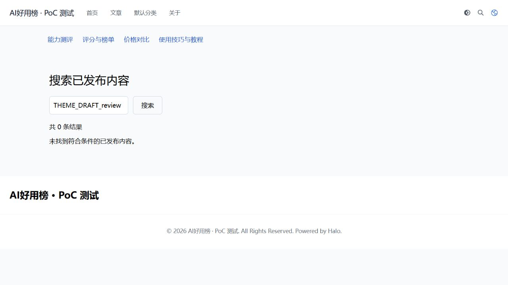

# 搜索、Feed 与站点地图专项验证

日期：2026-10-15（北京时间）。本轮恢复了搜索组件，补齐两套主题的独立搜索页，并通过四模块草稿隔离、发布更新和重启持久化检查。完整 P1–P8 仍有未验收项。本报告只覆盖指定测试环境 `/opt/aihyb-halo-poc`。

## 结果与当前状态

| 项目 | 结果 | 证据 |
|---|---|---|
| 搜索资源 | 搜索插件已启用；80 次 CSS/JS 请求与 180 次双工作线程混合页面、完整资源、Range 请求均成功 | [80 次检查](../demo/halo-poc/evidence/search-asset-after.json)、[180 次检查](../demo/halo-poc/evidence/search-asset-mixed-after.json) |
| 草稿隔离 | 保存、批准未发布、重建索引、Feed 全文、发布 B 后保存 C、恢复 A/B 六阶段均通过 | [六阶段结果](../demo/halo-poc/evidence/discovery-verification.json) |
| 主题搜索 | Earth → Anatole → Earth，公开结果可见、草稿结果不可见；切换不改变业务状态 | [Earth](../demo/halo-poc/evidence/discovery-earth-search.json)、[Anatole](../demo/halo-poc/evidence/discovery-anatole-search.json)、[切回 Earth](../demo/halo-poc/evidence/discovery-earth-search-restored.json) |
| 本地构建与复核 | 15 项 Java 测试、UI 类型检查和完整构建通过；独立复核关闭两项 Important，最终无 Critical/Important | `plugin-aihyb/build/test-results/test/`、[变更源码](../demo/halo-poc/plugin-aihyb/src/main/java/run/aihyb/pluginaihyb/NativeMirror.java) |
| 重启与备份 | 只重启本项目 Halo，13 秒恢复；所有业务状态一致，备份校验通过 | [重启对照](../demo/halo-poc/evidence/discovery-post-restart.json)、[制品与备份检查](../demo/halo-poc/evidence/discovery-final-artifacts.json) |
| 原有服务 | 受保护既有服务 PID 保持，forwarding=0，Halo 仍仅绑定本机，数据库无主机端口 | [运行检查](../demo/halo-poc/evidence/runtime-after-plugin.json) |

实际浏览器也验证了两主题的公开结果、草稿零结果与弹窗入口；重启后 Earth 仍返回草稿零结果。[浏览器记录及截图清单](../demo/halo-poc/evidence/discovery-browser-verification.json)

当前主题是 Earth，Feed 已恢复原 `excerpt` 模式。9 个受管理稿件中 6 个已发布；215 份完整修订、139 份稿件正文快照。四基准模块恢复为原公开 A 和原未批准 B，公开价格 49.00、草稿价格 59.91。验证中的保存与恢复会形成新修订、新审计时间和指针，不能将其称为运行前所有版本编号不变。另保留 2 个从未发布的诊断稿，后续复测复用它们；它们均未进入公开发现入口。主题切换及最后重启比较的是恢复完成后的冻结状态，期间全部内容、修订、快照和业务指针确实未变。

最终私密备份：`/opt/aihyb-halo-poc/backups/20261014T162611Z`。含数据库、Halo 工作目录、两主题搜索模板、插件、运行配置及账号文件；归档哈希和 PostgreSQL 备份目录均验证正常。此轮未将备份恢复至空实例，不能替代 P7 灾难恢复验收。

## 搜索插件问题与修复边界

此前 PluginSearchWidget 1.7.1 的样式请求出现 HTTP 500，堆栈为 `ZipException: invalid block type`，经过 `InflaterInputStream`、字节通道和 Spring `DataBufferUtils`。原 JAR 的 ZIP 完整性和文件字节校验正常。本轮重新启用原版后的有界请求未复现该错误，**精确的间歇触发条件仍未定位**，不能声称已经证明某个 Java 底层缺陷。

采取了可回退的定向加固：只将 `static/style.css` 和 `static/search-widget.iife.js` 两个 ZIP 条目的保存方式从 DEFLATED 改为 STORED，避开这两个资源读取时的解压步骤。全部 17 个条目的解压后字节、类文件、清单、CSS 和 JS 内容均相同，没有改业务代码。通过 Halo 原生升级接口替换该测试插件，并在本项目重启后复测。JAR 整体哈希因封装变化而不同，这是本地修补制品，并非新的官方发布版本。

- 原版 SHA-256：`1c7da1a954e4d6af12e95be10eec35c518d436acb578933b66e53c911395193b`。
- 加固版 SHA-256：`82b6ff64475dc30e6cb222a148ab968dca1702c68c697be67f34338188e159e7`。
- [逐条目比较清单](../demo/halo-poc/evidence/search-resourcefix-manifest.json)、[安装与原版备份](../demo/halo-poc/evidence/search-resourcefix-installed.json)、[原版复测样本](../demo/halo-poc/evidence/search-asset-before.json)。

260 次是小规模功能探测，不是持续压力测试或长期稳定性承诺。后续升级搜索插件时须保留此记录，优先验证官方版本是否解决静态资源问题。

## 公开发现入口与完整版本保护

搜索组件和独立 `/search` 页面使用 Halo 的原生索引。匿名接口 `POST /apis/api.halo.run/v1alpha1/indices/-/search` 强制公开、已发布、未回收过滤；本轮也尝试提交相反过滤参数，草稿仍不可检索。原生文章索引从 `releaseSnapshot` 获取正文，适配器只在批准并发布时切换公开标题、摘要、正文快照及 JSON 修订。公开读模型继续复用 PostgreSQL 与 Halo 原生索引，没有新增 Elasticsearch。

搜索结果的标题、描述、输入关键词使用模板转义输出；两主题共用搜索模板，跳转原生公开文章地址。输入框回显用户输入的草稿关键词属于正常搜索界面，验证只将结果条目当作内容泄露信号。

四类结构化字段分别用结论、教程工具版本、榜单理由、价格方案名和金额作独立标记，同时改变标题、摘要、正文和任务。每阶段检查私有标记不可见，也检查四份公开完整 `content/data` 仍等于指定发布版，避免只有“空结果”却连公开搜索也失效。

六阶段覆盖：

1. 保存 B 草稿，公众继续读 A。
2. 批准 B 但不发布，公众继续读 A。
3. B 存在时重建索引，草稿仍不可检索。
4. Feed 临时切换全文模式，验证正文及结构化表格仍取 A。
5. 发布 B，再保存未批准 C：搜索和 Feed 取 B，C 标记不可见。
6. 将原 A 内容重新发布、恢复原 B 草稿和 Feed 设置，再验证发现入口。

测试只写虚构 PoC 稿件。开始前备份四份完整稿件和 Feed ConfigMap；要求原草稿未批准。稿件恢复检查修订所有权；Feed 设置和恢复检查 ConfigMap 数据所有权并使用原生版本 CAS，发现其他编辑者修改则拒绝覆盖，而不是无条件“恢复旧设置”。最终恢复错误为空。

## Feed 和分类的两处修正

核验地址为 `/rss.xml`、`/feed.xml`、`/feed/authors/aihyb-admin.xml`、`/feed/tags/halo.xml`，以及四个分类 Feed：`reviews`、`tutorials`、`leaderboards`、`prices`。默认摘要和临时全文两种模式均检查 XML 内草稿标记、标题、公开条目及全文结构化内容。标签 Feed 不要求无对应标签的稿件出现；全站、作者和模块分类 Feed 均有公开正向断言。

首先发现分类引用用了 slug，而 Halo `Post.spec.categories` 要求 Category 的真实 `metadata.name`。已改为按唯一分类 slug 查到真实名称；只修复已知旧悬空引用，其余状态不变，陌生分类变更拒绝自动覆盖。[迁移证据](../demo/halo-poc/evidence/native-category-repair.json)

其次发现 Feed 1.5.0 的原生 PostUpdated 缓存清除遗漏 `/feed.xml` 别名和标签路由。主 RSS 已显示新公开 B，但别名仍显示旧公开 A；这是发布更新缓存遗漏，没有显示私人草稿。适配器在原子发布提交后，通过 Feed 的公开共享事件 `RssCacheClearRequested.forAll` 清除这些缓存，复测八条路由均正常。

构建依赖从官方 Feed 1.5.0 制品抽取的三个未修改 API 类，仅 `compileOnly`，最终业务 JAR 不包含这些类；运行时声明 `PluginFeed >=1.5.0`。本轮实际只验证 1.5.0，未来版本必须重新测试。上游 GPL-3.0 许可及字节出处见 [API 说明](../demo/halo-poc/plugin-aihyb/libs/README.md)。

Post CAS 重试仅覆盖提交阶段。通知异常不会使已提交的发布报失败或重复提交；提交失败不会发清缓存事件。通知失败只记录不含稿件内容的告警，当前没有持久重试机制。因此异常情况下不承诺 Feed 立即刷新，运营需检查日志并在排除原因后重新触发缓存清除；正式部署应补齐监控与可靠失效机制。

## 站点地图及未验收范围

`/sitemap.xml` 包含四份公开原生文章地址，不包含诊断未发布稿、后台或预览地址。Sitemap 1.3.0 本身只输出链接及修改时间，不承担 JSON 展示；标题、正文或结构化数据的发现隔离还要由搜索及 Feed 分别验证。其原生缓存 TTL 为 30 秒，本轮 A→B 复用了同一 URL，不构成新 URL 即时出现或撤稿即时消失的验证。

此次未验收 CDN、公开 HTML/API 缓存、私有附件、视频组件、定时发布、撤稿、持续负载、真实用户线路、整实例恢复或核心升级回退。Feed 全文中的媒体权限须在接入对象存储后另测。正式部署尤其不能把预览、后台和原始资源加入共享缓存。

## 复现与回退

所有脚本仅在指定 PoC 目录使用，凭据由受限本地文件读取，不输出密码或 Cookie。完整流程 `verify-discovery.py` 会保存/批准/发布虚构数据并恢复原内容，要求四份未批准基准草稿。`verify-discovery-state.py freeze` 冻结私密业务基线；随后 `earth-search`、`anatole-search theme-anatole`、`earth-search-restored theme-earth`、`post-restart` 检查无业务改动。`probe-search.py --after` 和 `probe-search-mixed.py --after` 生成新探测证据。`record-runtime.py` 核对已有服务隔离。

搜索原版保存在 `/opt/aihyb-halo-poc/backups/search-resourcefix-20261014T155242Z/PluginSearchWidget-1.7.1.jar`。出现新故障时先用原生插件状态接口仅停用 `PluginSearchWidget`，再核对原版 SHA-256，使用同一原生升级接口恢复该 JAR，保持停用；未来再次启用前对本项目 Halo 重启以清理旧 JAR URL 缓存并重测资源。不要卸载 Feed 来回退搜索，它现在是适配器的运行依赖。

业务插件与分类修正前的整环境备份为 `/opt/aihyb-halo-poc/backups/20261014T155245Z`（已含搜索资源加固）；最后运行备份为 `20261014T162611Z`。恢复数据库与工作目录必须作为同一组处理，仅针对该项目，并保留恢复前现状。旧备份不包含此轮后来产生的修订，不能只还原数据库或只替换业务插件来保持完整版本保护。此轮保留了可核验回退材料与步骤，未执行故障注入或整实例回退演练。

依据本轮已读取的官方固定版本源码：[搜索组件 1.7.1](https://github.com/halo-dev/plugin-search-widget/tree/v1.7.1)、[Halo 2.26.1 原生索引提供器](https://github.com/halo-dev/halo/blob/v2.26.1/application/src/main/java/run/halo/app/search/post/PostHaloDocumentsProvider.java)、[Feed 1.5.0](https://github.com/halo-dev/plugin-feed/tree/v1.5.0)、[Sitemap 1.3.0](https://github.com/halo-dev/plugin-sitemap/tree/v1.3.0)。源码快照位于 `demo/halo-poc/evidence/discovery-sources`，行为结论以实测证据为界。

